  

🇦🇷 <strong>ES</strong> · English version at the end ↓

## Hola, soy Mateo 👋

Desarrollador **full stack & creative developer** de Argentina (Técnico en Programación) — donde más disfruto es en el **front-end**: interfaces que se mueven, responden y se sienten vivas. Trabajo en el borde creativo de la web con **Vue 3, Nuxt 4, GSAP y WebGL**, combinándolo con arquitectura de backend y datos: APIs REST, FastAPI, Node, Prisma y PostgreSQL.

- 🌐 **[Explorador Técnico & Portafolio en Vivo](https://portfolio-phi-rust-14.vercel.app)**
- 🎓 Año de tesis en **Escuela Da Vinci** — promoción 2026
- 🧠 Co-creador de **[Ynara](https://github.com/BriarDevv/Ynara)**, asistente personal de IA adaptativo y on-prem (+380 commits)
- 🌒 Me gustan las UIs oscuras, la tipografía editorial y las terminales

## Proyectos destacados

| Proyecto | Qué es | Stack |
| :--- | :--- | :--- |
| **[Portfolio Técnico](https://github.com/MateoGs013/portfolio)** | Explorador relacional de base de datos técnica, CV dual interactivo (Harvard ATS / Modern IDE) y micro-interacciones táctiles. [En producción](https://portfolio-phi-rust-14.vercel.app). | `Nuxt 4` `Vue 3` `Prisma` `PostgreSQL` |
| **[Ynara](https://github.com/BriarDevv/Ynara)** | Asistente de IA adaptativo, on-prem y en rioplatense, con memoria cifrada semántica / episódica / procedural. **Contribuidor principal — más de 380 commits.** | `FastAPI` `Next.js` `Expo` `pgvector` `Ollama` |
| **[Eros Career OS](https://github.com/MateoGs013/eros-agent)** | Sistema multiagente autónomo para búsqueda de empleo tech y generación omnicanal con Google Gemini Free Tier y n8n. | `Python` `FastAPI` `Gemini` `n8n` |
| **[La Rúcula](https://laruculagastrobar.es/)** | Sitio editorial premium para un gastrobar frente al mar en España. **Cliente real, en producción.** [Código fuente](https://github.com/MateoGs013/LaRucula). | `Vue 3` `GSAP` `Lenis` |
| **[ARG Piscinas](https://www.argpiscinas.es/)** | Web corporativa multi-idioma (ES/EN/DE) con panel autoadministrable y blog. **Cliente real, en producción.** [Código fuente](https://github.com/MateoGs013/argpiscinas). | `Vue 3` `Node` `Prisma` |
| **[Ynara-Web](https://github.com/MateoGs013/Ynara-Web)** | Sitio inmersivo WebGL: una forma de luz que morfea con el scroll. **Tesis Da Vinci, 2026.** | `TypeScript` `WebGL` `GSAP` |
| **[barberpole](https://github.com/MateoGs013/barberpole)** | SaaS de turnos para peluquerías, identidad neo-brutalista. [Demo en vivo](https://parcial-2-peluqueria.vercel.app/). | `React` `Express` `MongoDB` |

## Stack

  
  
  
  
  
  
  
  
  
  
  
  

## Cómo trabajo

Programo en pareja con IA — el famoso **vibe coding**, sin esconderlo. Claude Code vive en mi flujo diario: la dirección creativa, la arquitectura y el gusto son míos; la velocidad es compartida. Por eso mis repos versionan su configuración de agentes (`.claude/`, `AGENTS.md`) y mis commits llevan co-autoría real.

  
  
  

## Contacto & CV

- 🌐 **Web:** [portfolio-phi-rust-14.vercel.app](https://portfolio-phi-rust-14.vercel.app)
- 📄 **Curriculum Vitae:** [Versión interactiva Harvard ATS / Modern IDE](https://portfolio-phi-rust-14.vercel.app/docs/about)
- 💼 **LinkedIn:** [linkedin.com/in/mateo-sonzogni](https://www.linkedin.com/in/mateo-sonzogni)
- 📫 **Email:** [mateogabus@gmail.com](mailto:mateogabus@gmail.com)

---

🇬🇧 <strong>English version</strong>

 

## Hey, I'm Mateo 👋

**Full stack & creative developer** from Argentina (certified Programming Technician) — happiest on the **front-end**: interfaces that move, respond, and feel alive. I work at the creative edge of the web with **Vue 3, Nuxt 4, GSAP, and WebGL**, backed by robust backend and database architecture: REST APIs, FastAPI, Node, Prisma, and PostgreSQL.

- 🌐 **[Live Technical Explorer & Portfolio](https://portfolio-phi-rust-14.vercel.app)**
- 🎓 Thesis year at **Escuela Da Vinci** — class of 2026
- 🧠 Co-creator of **[Ynara](https://github.com/BriarDevv/Ynara)**, an on-prem adaptive AI personal assistant (380+ commits)
- 🌒 Into dark UIs, editorial typography, and terminal interfaces

### Featured work

| Project | About | Stack |
| :--- | :--- | :--- |
| **[Technical Portfolio](https://github.com/MateoGs013/portfolio)** | Relational database explorer, interactive dual CV (Harvard ATS / Modern IDE), and tactile micro-interactions. [Live in production](https://portfolio-phi-rust-14.vercel.app). | `Nuxt 4` `Vue 3` `Prisma` `PostgreSQL` |
| **[Ynara](https://github.com/BriarDevv/Ynara)** | On-prem adaptive AI assistant with encrypted semantic / episodic / procedural memory. **Core contributor — 380+ commits.** | `FastAPI` `Next.js` `Expo` `pgvector` `Ollama` |
| **[Eros Career OS](https://github.com/MateoGs013/eros-agent)** | Autonomous multi-agent system for tech job hunting and omnichannel publishing with Google Gemini Free Tier and n8n. | `Python` `FastAPI` `Gemini` `n8n` |
| **[La Rúcula](https://laruculagastrobar.es/)** | Premium editorial site for a beachfront gastrobar in Spain. **Real client, in production.** [Source code](https://github.com/MateoGs013/LaRucula). | `Vue 3` `GSAP` `Lenis` |
| **[ARG Piscinas](https://www.argpiscinas.es/)** | Multi-language corporate site (ES/EN/DE) with custom admin panel and blog. **Real client, in production.** [Source code](https://github.com/MateoGs013/argpiscinas). | `Vue 3` `Node` `Prisma` |
| **[Ynara-Web](https://github.com/MateoGs013/Ynara-Web)** | Immersive WebGL site: a generative light form that morphs as you scroll. **Da Vinci thesis, 2026.** | `TypeScript` `WebGL` `GSAP` |
| **[barberpole](https://github.com/MateoGs013/barberpole)** | Appointment SaaS for hair salons, neo-brutalist identity. [Live demo](https://parcial-2-peluqueria.vercel.app/). | `React` `Express` `MongoDB` |

### How I work

I pair-program with AI — yes, **vibe coding**, out in the open. Claude Code lives in my daily flow: creative direction, architecture, and taste are mine; the speed is shared. That's why my repos version their agent config (`.claude/`, `AGENTS.md`) and my commits carry honest co-authorship.

### Contact & Resume

- 🌐 **Web:** [portfolio-phi-rust-14.vercel.app](https://portfolio-phi-rust-14.vercel.app)
- 📄 **Resume / CV:** [Interactive Harvard ATS / Modern IDE version](https://portfolio-phi-rust-14.vercel.app/docs/about)
- 💼 **LinkedIn:** [linkedin.com/in/mateo-sonzogni](https://www.linkedin.com/in/mateo-sonzogni)
- 📫 **Email:** [mateogabus@gmail.com](mailto:mateogabus@gmail.com)

 

hecho con 🧉 y monospace desde Argentina

